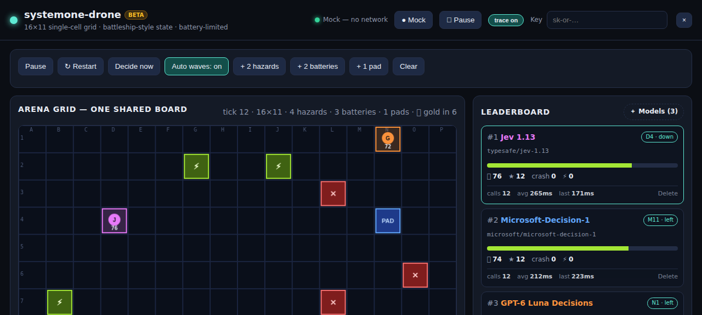

# systemone-drone

N drones fly on one shared 16x11 grid. Each drone is controlled by a System One decision model through OpenRouter.

Live demo: https://wnoronha.github.io/systemone-drone



## Run

```
python3 -m http.server 8080
```

Open http://localhost:8080. Mock mode runs with no key.

## Go live

1. Paste an OpenRouter key in the header field. The key stays in browser localStorage.
2. Flip Mock to LIVE.
3. Press Start. Paused means zero API calls.

Use + Models to add or remove decision models.

## Rules

- Move costs 3 battery. Hover costs 1. Wall hit costs 5. Hazard costs 10.
- Battery cell gives +30. Landing pad gives +50 and refills battery to 100, then moves to a new cell.
- Battery below 50 is a warning. Below 30 is critical. At 0 the drone is dead.
- Max 3 hovers in a row. Then the drone must move.
- First drone to a pad cell claims it. A late drone hovers.
- Gold rush: one pad pays double, first claim only.
- Change all numbers in the Rules panel. No code change is necessary.
